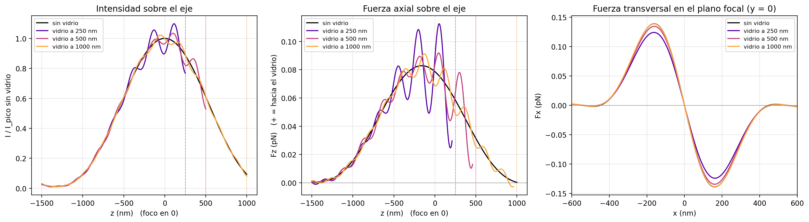

# PyForce

Simulación de fuerzas ópticas sobre una nanopartícula de oro en una **trampa
óptica contrapropagante**: un haz gaussiano y un haz dona (vórtice) enfocados
por objetivos opuestos. Los campos en el foco se calculan con
[PyFocus](https://github.com/Stefani-Lab/PyFocus) (Richards-Wolf) y a partir de
ellos se obtienen las fuerzas de gradiente, scattering y spin-curl en los planos
XY y XZ.

Proyecto de Laboratorio 6 y 7.

## Instalación

Requiere Python 3.10 (es la versión con la que se probó PyCustomFocus 3.4.0).

```bash
conda create -n pyfocus python=3.10
conda activate pyfocus
pip install -r requirements.txt
```

## Uso

```bash
python main.py            # campos -> fuerzas -> gráficos; guarda los campos en .npz
python grafico_lindo.py   # figura resumen 3x3 a partir de los .npz
python particula.py       # comparación Kuwata vs Mie de la polarizabilidad
python calibracion_foco.py
python fuerzas_gauss_interfaz.py   # gauss con y sin el vidrio -> resultados/gauss_interfaz/
python validar_interfaz.py         # chequeos de interfaz.py contra PyFocus
```

`main.py` y `calibracion_foco.py` están divididos en celdas (`#%%`) para
correrlos de a partes en Spyder o VS Code.

Para reusar los campos guardados en otro script:

```python
import numpy as np
data = np.load('campos_dona_aceite.npz')
Ex_xy, Ey_xy, Ez_xy = data['Ex_xy'], data['Ey_xy'], data['Ez_xy']   # V/m
Ex_xz, Ey_xz, Ez_xz = data['Ex_xz'], data['Ey_xz'], data['Ez_xz']
```

## Estructura

| Archivo | Qué hace |
|---|---|
| `sim_config.py` | **Único lugar** con los parámetros compartidos: radio de la partícula, índices de los medios, grilla de PyFocus, paso de las derivadas y extensión de los planos XY/XZ. |
| `beams/gauss.py`, `beams/dona.py` | Parámetros propios de cada haz (`NA`, `n`, `h`, `w0`, `λ`, polarización, `I0`) y su `get_field()`. |
| `particula.py` | Polarizabilidad del oro (tabla de Johnson & Christy 1972): Kuwata (`calc_alpha`, la que se usa) y Mie exacto (`calc_alpha_mie`, para validar). |
| `fuerzas.py` | Funciones puras: factor de conversión a V/m, fuerzas en XY y XZ, espejado del haz contrapropagante. |
| `graficos.py` | Mapas de magnitud + streamplot, comparación entre haces, desglose en componentes e intensidad. |
| `grafico_lindo.py` | Figura resumen 3x3 (XY, XZ y corte de Fz en z = 0 con FWHM) a partir de los `.npz`. |
| `pyfocus_wrapper.py` | Capa entre el código y PyFocus: lo corre sin abrir figuras, corrige la doble división λ/n y da el factor de conversión a SI. |
| `calibracion_foco.py` | De lo medido en el foco a los `w0`/`I0` del back focal plane (ver abajo). |
| `calibracion_foco_gauss.py` | Predicción rápida del foco del haz gaussiano para unos `w0`/`I0` a mano. |
| `calibracion.json` | Resultado de la calibración; lo leen `beams/*.py` al importarse. |
| `interfaz.py` | Foco de un haz gaussiano con una interfaz plana (agua/vidrio): Richards-Wolf + Fresnel, mismas grillas y unidades que PyFocus. |
| `validar_interfaz.py` | Chequea `interfaz.py`: sin interfaz coincide con `sim.no_mask` a 1e-14; con interfaz cumple las condiciones de borde. |
| `fuerzas_gauss_interfaz.py` | Fuerzas del gauss calibrado sin vidrio y con el vidrio a varias distancias del foco. |
| `resultados/` | Figuras y resúmenes publicados (ver [Resultados](#resultados)). |
| `Objetivos.txt` | NA, n, h y f de los objetivos disponibles. |

## Detalles de la física y de PyFocus

**Unidades de PyFocus.** PyFocus usa `I0` literalmente como `|E0|²` (sin el
factor `n·c·ε₀/2`) y no incluye el `sqrt(n1/n2)` de Richards-Wolf. El factor
para pasar a V/m es entonces una constante que depende del índice del medio del
foco: `E_SI = E_PyFocus · sqrt(20 / (n_foco · c · ε₀))`. Con eso,
`I_foco [mW/cm²] = |E_PyFocus|²`. Ver `pyfocus_wrapper.factor_E_foco`.

**λ/n aplicada dos veces (PyCustomFocus 3.4.0).** `main_calculation_handler.py`
y `base.py` dividen ambos la longitud de onda por n: con n > 1 el foco sale
~n veces más chico. `pyfocus_wrapper.detectar_doble_division()` lo mide en cada
entorno (~3 s) y, si hace falta, le pasa λ·n.

**Grilla.** El paso entre puntos es `x_steps`/`z_steps` (5 nm); las derivadas
de `fuerzas.py` usan ese mismo paso. El plano XY cubre `x_range` en x e y. El
plano XZ cubre `z_range` en z pero `√2·x_range` en x (PyFocus llega hasta la
esquina de la grilla XY), y sus filas van de −z a +z.

**Haz contrapropagante.** La dona viaja hacia −z: sus fuerzas XZ son la imagen
especular (z → −z) de las simuladas (`fuerzas.espejar_haz_contrapropagante`).

**Spin-curl en XZ.** `fuerzas_xz` devuelve el término de spin-curl por separado
pero no lo suma al total (sí lo hace `fuerzas_xy`).

**Interfaz agua/vidrio.** El portaobjetos (n = 1.52, con aceite de índice
igualado abajo) se trata como semi-infinito. PyFocus no sirve para esto:
`sim.no_mask`/`sim.VP` ignoran la interfaz, y en `sim.custom` (3.4.0) la onda
reflejada de la componente x no lleva la fase `exp(2i k1 cosθ z_int)`, así que
con polarización en x solo es correcta con la interfaz en el foco.
`interfaz.py` lo resuelve por su cuenta (ver su docstring).

**Otras rarezas de PyFocus** (no cambian |E|², ni las fuerzas de gradiente y
scattering): `sim.no_mask` devuelve Ez con el signo opuesto al físico, y su
plano XY tiene las filas de +y a −y, la grilla corrida medio píxel en y y el
radio de cada píxel redondeado.

## Resultados

### Haz gaussiano con y sin el vidrio (`resultados/gauss_interfaz/`)

Gauss calibrado (FWHM = 330 nm, P = 1 mW), NP de Au de 40 nm en agua, vidrio a
d = 250, 500 y 1000 nm del foco. Tabla completa en
[`resumen.md`](resultados/gauss_interfaz/resumen.md).





- La reflexión en el vidrio (≈ 0.5 % en intensidad a incidencia normal)
  interfiere con el haz incidente y modula la intensidad sobre el eje en
  ±10 % con período λ/2n ≈ 220 nm. Fz pasa a oscilar alrededor del valor sin
  vidrio, con picos de hasta 1.4 veces.
- En el plano focal el cambio es chico: con el vidrio a 250 nm la rigidez
  transversal baja de 1.40 a 1.25 pN/µm; a 1000 nm ya no se nota.
- Con un solo haz gaussiano no hay trampa axial (con o sin vidrio): la fuerza
  de scattering gana en todo el eje y empuja la partícula hacia el vidrio.
  Transversalmente sí atrapa (pozo de ~8 kT a 1 mW).

## Calibración foco → BFP (`calibracion_foco.py`)

`w0` e `I0` de `beams/gauss.py` y `beams/dona.py` son los del back focal plane
(antes del objetivo), pero lo que se mide es lo que hay en el foco:

1. `predecir_foco(gauss)` / `predecir_foco(dona)`: qué foco (ancho, intensidad
   pico, potencia) dan los `w0`/`I0` actuales, para comparar con lo medido.
2. `calibrar_haz(haz, w_foco_nm=..., P_mW=... y/o I_pico_kWcm2=...)`: invierte
   el problema. Como PyFocus es lineal en el campo, la forma del foco depende
   solo de `w0` (se barre y se afina con `brentq`) e `I0` sale por cociente con
   la potencia o la intensidad pico. Si se miden las tres cosas, la tercera
   queda como chequeo de consistencia.
3. `guardar_calibracion(res)` escribe `calibracion.json`, que `beams/*.py` leen
   solos. `USAR_CALIBRACION = False` en `sim_config.py` vuelve a los valores
   escritos a mano; `borrar_calibracion()` limpia el json.

Métricas de ancho: `'fwhm'` y `'r_1e2'` (gauss), `'r_anillo'` y
`'grosor_anillo'` (dona). Unidades: ancho en nm, `P_mW` en la muestra,
`I_pico_kWcm2` en kW/cm², `I0` en mW/cm².

## Pendientes

- La posición del máximo de la polarizabilidad de Kuwata cambia poco con el
  radio de la NP. Puede ser el límite del modelo; `particula.comparar_radios()`
  lo compara con Mie exacto.
- Agregar la interfaz al haz dona (necesita la máscara de vórtice en
  `interfaz.py`) y armar la trampa contrapropagante completa con el vidrio.
- Falta calibrar el haz dona (`calibracion.json` solo tiene el gauss).
