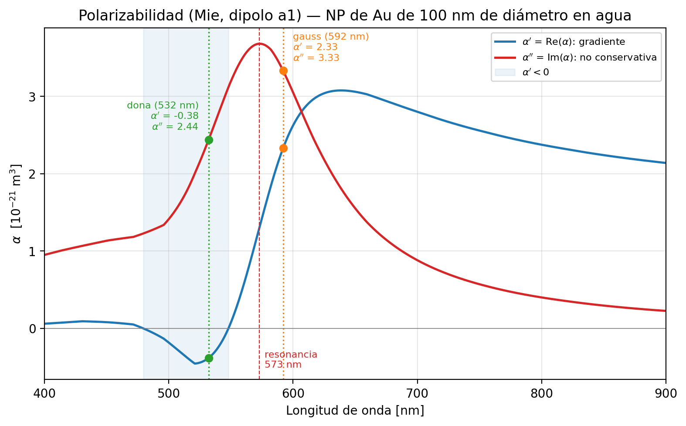
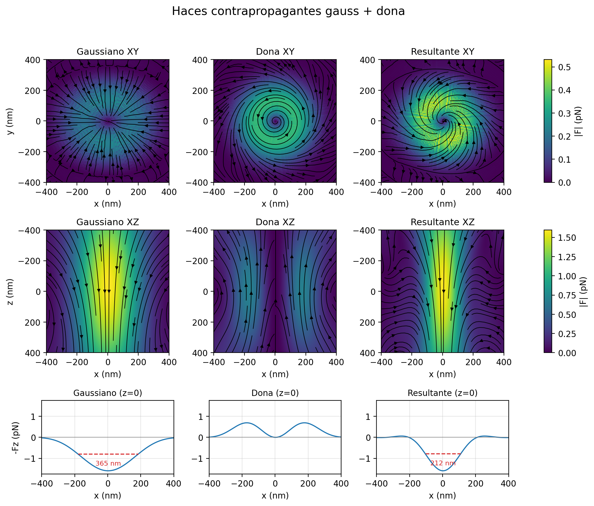
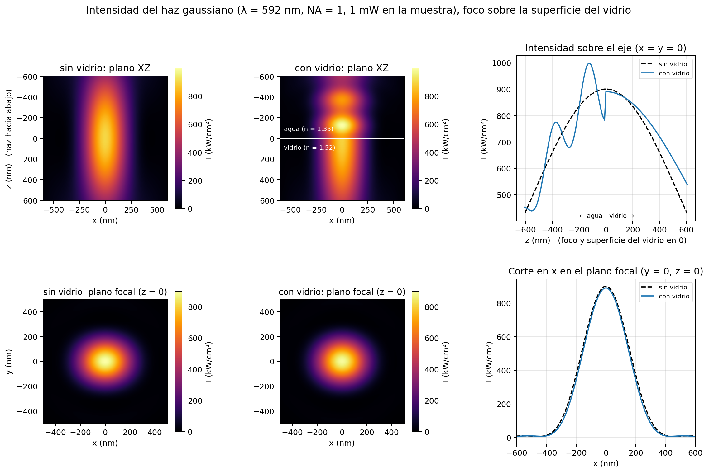
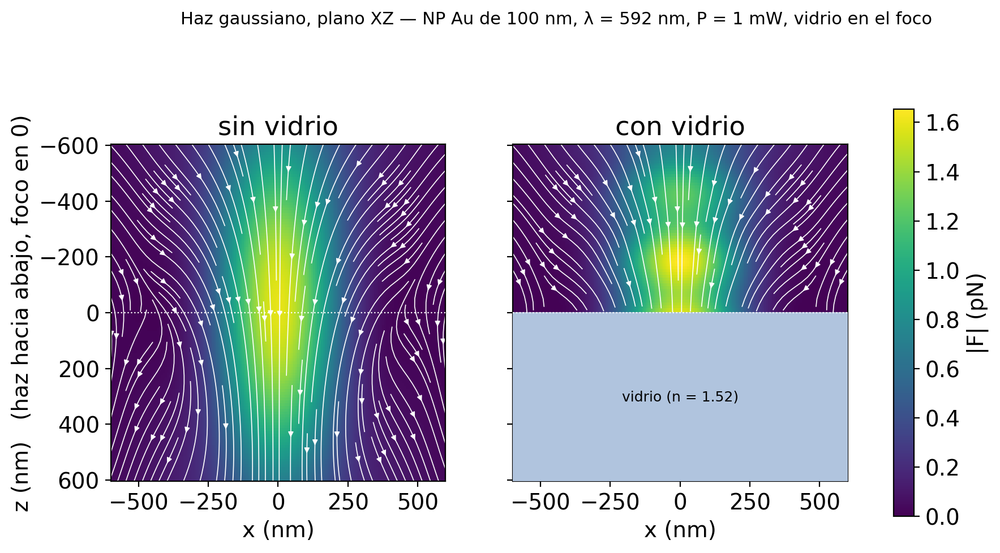
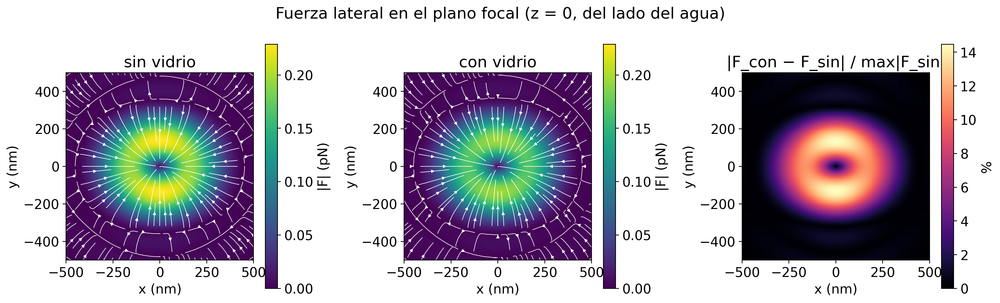

# PyForce

Simulación de las fuerzas ópticas en el **printing óptico** de nanopartículas
de oro: la luz empuja la partícula, que está en agua, hasta el portaobjetos de
vidrio, donde queda impresa. Se usan dos haces enfocados por objetivos opuestos
(contrapropagantes): un haz gaussiano y un haz dona. Los campos en el
foco se calculan con [PyFocus](https://github.com/Stefani-Lab/PyFocus)
(Richards-Wolf), incluida la interfaz agua/vidrio con el foco sobre el vidrio,
y a partir de ellos se obtienen las fuerzas de gradiente, scattering y
spin-curl en los planos XY y XZ.

Proyecto de Laboratorio 6 y 7.

## Instalación

Requiere Python 3.10 (es la versión con la que se probó PyCustomFocus 3.4.0).

```bash
conda create -n pyfocus python=3.10
conda activate pyfocus
pip install -r requirements.txt
```

## Uso

```bash
python main.py            # campos -> fuerzas -> gráficos; guarda los campos en .npz
python grafico_lindo.py   # figura resumen 3x3 a partir de los .npz
python particula.py       # polarizabilidad de Mie, Mie completo vs dipolo, comparación con Kuwata
python calibracion_foco.py
python fuerzas_gauss_interfaz.py   # printing con el gauss, con y sin vidrio -> resultados/gauss_interfaz/ (~15 min)
python intensidad_gauss_interfaz.py  # intensidad del gauss, con y sin vidrio (~15 min)
```

`main.py` y `calibracion_foco.py` están divididos en celdas (`#%%`) para
correrlos de a partes en Spyder o VS Code.

Para reusar los campos guardados en otro script:

```python
import numpy as np
data = np.load('campos_dona_aceite.npz')
Ex_xy, Ey_xy, Ez_xy = data['Ex_xy'], data['Ey_xy'], data['Ez_xy']   # V/m
Ex_xz, Ey_xz, Ez_xz = data['Ex_xz'], data['Ey_xz'], data['Ez_xz']
```

## Estructura

| Archivo | Qué hace |
|---|---|
| `sim_config.py` | **Único lugar** con los parámetros compartidos: radio de la partícula, índices de los medios, grilla de PyFocus, paso de las derivadas y extensión de los planos XY/XZ. |
| `beams/gauss.py`, `beams/dona.py` | Parámetros propios de cada haz (`NA`, `n`, `h`, `w0`, `λ`, polarización, `I0`) y su `get_field()`. |
| `particula.py` | Polarizabilidad del oro con teoría de Mie (tabla de Johnson & Christy 1972): `calc_alpha` (dipolo a1, la que se usa), coeficientes y secciones eficaces completas, y Kuwata solo para comparar. |
| `fuerzas.py` | Funciones puras: factor de conversión a V/m, fuerzas (gradiente + scattering + spin-curl) en XY y XZ, espejado del haz contrapropagante. |
| `graficos.py` | Mapas de magnitud + streamplot, comparación entre haces, desglose en componentes e intensidad. |
| `grafico_lindo.py` | Figura resumen 3x3 (XY, XZ y corte de Fz en z = 0 con FWHM) a partir de los `.npz`. |
| `pyfocus_wrapper.py` | Capa entre el código y PyFocus: lo corre sin abrir figuras, corrige la doble división λ/n, pasa la salida a la convención física (Ez y eje y) y da el factor de conversión a SI. `campo_foco_vidrio` calcula el foco con el vidrio (`sim.custom`). |
| `calibracion_foco.py` | De lo medido en el foco a los `w0`/`I0` del back focal plane (ver abajo). |
| `calibracion_foco_gauss.py` | Predicción rápida del foco del haz gaussiano para unos `w0`/`I0` a mano. |
| `calibracion.json` | Resultado de la calibración; lo leen `beams/*.py` al importarse. |
| `fuerzas_gauss_interfaz.py` | Printing con el gauss calibrado: fuerzas sin vidrio y con el vidrio en el foco. |
| `intensidad_gauss_interfaz.py` | Intensidad del gauss calibrado sin vidrio y con el vidrio en el foco. |
| `resultados/` | Figuras y resúmenes publicados (ver [Resultados](#resultados)). |
| `Objetivos.txt` | NA, n, h y f de los objetivos disponibles. |

## Fuerzas sobre la partícula

La NP de oro (diámetro 100 nm) es chica frente a la longitud de onda en agua
(λ/n ≈ 400–450 nm), así que se la trata como un **dipolo** inducido
`p = ε₀ εm α E`. La polarizabilidad α sale de la teoría de Mie (coeficiente
a1, `particula.calc_alpha`). Sus dos partes juegan papeles distintos:

- **α′ (parte real):** la NP responde en fase con el campo. Da la fuerza de
  gradiente.
- **α″ (parte imaginaria):** la NP absorbe y dispersa luz. Da el scattering y
  el spin-curl.

Para el oro, cerca de la resonancia plasmónica, α″ es del orden de α′ o
mayor:

| λ (haz) | α′ (m³) | α″ (m³) |
|---|---|---|
| 592 nm (gauss) | 2.33e-21 | 3.33e-21 |
| 532 nm (dona) | −0.38e-21 | 2.44e-21 |



Figura de `particula.py` (`graficar_alpha`). La resonancia (máximo de α″) está
en 573 nm; en la franja sombreada (479–548 nm) α′ < 0. Los quiebres de las
curvas vienen de interpolar linealmente la tabla de Johnson & Christy, que
tiene un punto cada ~20–40 nm.

La fuerza sobre el dipolo, `F = (ε₀ εm / 2) Re[α* Σⱼ Eⱼ* ∇Eⱼ]`, se separa en
tres términos (`fuerzas.py` los calcula por separado y los suma):

1. **Gradiente** — `F_grad = (ε₀ εm α′ / 4) ∇|E|²`.
   Es conservativa. Con α′ > 0 lleva la NP hacia donde la luz es más
   intensa; con α′ < 0, hacia donde es menos intensa. A 532 nm, α′ < 0 para
   esta NP: el gradiente de la dona la empuja hacia el centro oscuro del
   anillo, no hacia el anillo.

   Eso es correcto. Como en cualquier oscilador, α′ cambia de signo al
   cruzar la resonancia: es positiva del lado rojo y negativa del lado azul.
   La resonancia dipolar de una NP de oro de 100 nm en agua está en 573 nm
   (máximo de α″; el pico de extinción con Mie completo da 569 nm), y
   α′ < 0 entre 479 y 548 nm. Para NPs chicas la resonancia está cerca de
   520 nm y a 532 nm α′ > 0. El cambio de signo a 532 nm ocurre en un
   diámetro de ≈ 83 nm. Cerca de ese tamaño |α′| es chica y el gradiente pesa
   poco frente al scattering.
2. **Scattering (presión de radiación)** — `F_scat = (ε₀ εm α″ / 2) Im[E* × (∇ × E)]`.
   Sigue el flujo de energía (vector de Poynting), o sea, empuja en el
   sentido en que viaja la luz. Para el oro es la fuerza dominante: es la que
   **lleva la NP hasta el vidrio y la imprime**.
3. **Spin-curl** — `F_sc = (ε₀ εm α″ / 2) Im[(E* · ∇) E]`.
   Viene del rotor de la densidad de espín de la luz. En un foco muy cerrado
   el campo tiene componente Ez en cuadratura con Ex, y aparece aunque el haz
   esté polarizado linealmente. En el foco del gauss **se opone al
   scattering** y le resta ~15 %.

Gradiente + scattering + spin-curl da exactamente la fuerza dipolar
(se verificó numéricamente). El scattering tiene que ser el de Poynting: el
término "orbital" `Im[Eⱼ* ∇Eⱼ]` ya incluye el spin-curl.

**Para imprimir** hace falta una fuerza hacia el vidrio de **≈ 0.6 pN**
(medido; `sim_config.F_IMPRESION_pN`). Lateralmente, el
gradiente lleva la NP hacia el eje del haz, lo que fija dónde queda impresa.

**Validez del modelo dipolar.** Con a = 50 nm, los multipolos más altos de Mie
pesan poco. Comparando la presión de radiación de una onda plana con Mie
completo y solo con a1 (`particula.secciones_eficaces`), el dipolo la
subestima un 1 % a 592 nm y un 4 % a 532 nm. No se incluyen la interacción de
la NP con su propia imagen en el vidrio ni fuerzas de contacto (van der
Waals, electrostáticas).

## Detalles de la física y de PyFocus

**Unidades de PyFocus.** PyFocus usa `I0` literalmente como `|E0|²` (sin el
factor `n·c·ε₀/2`) y no incluye el `sqrt(n1/n2)` de Richards-Wolf. El factor
para pasar a V/m es entonces una constante que depende del índice del medio del
foco: `E_SI = E_PyFocus · sqrt(20 / (n_foco · c · ε₀))`. Con eso,
`I_foco [mW/cm²] = |E_PyFocus|²`. Ver `pyfocus_wrapper.factor_E_foco`.

**λ/n aplicada dos veces (PyCustomFocus 3.4.0).** `main_calculation_handler.py`
y `base.py` dividen ambos la longitud de onda por n: con n > 1 el foco sale
~n veces más chico. `pyfocus_wrapper.detectar_doble_division()` lo mide en cada
entorno (~3 s) y, si hace falta, le pasa λ·n.

**Grilla.** El paso entre puntos es `x_steps`/`z_steps` (5 nm); las derivadas
de `fuerzas.py` usan ese mismo paso. El plano XY cubre `x_range` en x e y. El
plano XZ cubre `z_range` en z pero `√2·x_range` en x (PyFocus llega hasta la
esquina de la grilla XY), y sus filas van de −z a +z.

**Haz contrapropagante.** La dona viaja hacia −z: sus fuerzas XZ son la imagen
especular (z → −z) de las simuladas (`fuerzas.espejar_haz_contrapropagante`).

**Derivadas fuera del plano.** Scattering y spin-curl necesitan derivadas
perpendiculares al plano calculado (∂/∂z en XY, ∂/∂y en XZ), que un plano
solo no tiene. La de la componente normal sale de div E = 0 y las otras se
toman como cero. Para polarización lineal en x eso es exacto en XZ; con
polarización circular (la dona) el spin-curl queda ~50 % mal.

**Interfaz agua/vidrio.** El portaobjetos (n = 1.52, con aceite de índice
igualado abajo) se trata como semi-infinito, con su superficie **en el
foco**. Se calcula con `sim.custom` de PyFocus, la única función que tiene en
cuenta una interfaz (`sim.no_mask`/`sim.VP` la ignoran), a través de
`pyfocus_wrapper.campo_foco_vidrio`. Esa función corrige que `sim.custom` da
los campos ~1 % más chicos (pesa mal los extremos de la integral) y los pasa a
la misma convención que el resto. Sin vidrio coincide con `sim.no_mask` a
5e-4. 

**Convención de PyFocus.** `sim.no_mask`/`sim.VP` devuelven Ez con el signo
opuesto al físico (con su Ez, div E ≠ 0) y el plano XY con las filas de +y a −y.
`pyfocus_wrapper.campo_foco` corrige las dos cosas. Quedan dos detalles del
plano XY de PyFocus: la grilla está corrida medio píxel en y, y el radio de
cada píxel se redondea, lo que mete ruido en las derivadas.

## Resultados

### Haces contrapropagantes gauss + dona, sin vidrio (`resultados/haces_contrapropagantes/`)

Figura de `grafico_lindo.py` (a partir de los campos que guarda `main.py`). NP
de oro de 100 nm en agua, sin vidrio. Gauss calibrado a 1 mW (592 nm, baja
desde arriba). La dona (532 nm, polarización circular, sube desde abajo) **no
está calibrada**: se usan w0 = 5 mm e I0 = 6.1 mW/cm², que dan 1 mW en la
muestra.



- **Fila 1, plano focal (XY):** el gauss lleva la NP hacia el eje. La dona
  lleva momento angular, y su fuerza
  tiene una componente azimutal que hace girar la NP alrededor del eje.
- **Fila 2, plano XZ (+z hacia abajo):** el gauss empuja hacia abajo en el
  eje; la dona empuja hacia arriba en su anillo.
- **Fila 3, −Fz en z = 0 (negativo = hacia abajo):** al sumar los dos haces,
  la dona cancela el empuje del gauss lejos del eje. La zona que empuja
  hacia abajo se angosta de 365 nm (FWHM, solo gauss) a 212 nm.

Limitaciones: el spin-curl de la dona (polarización circular) queda
aproximado con los planos de PyFocus (ver "Derivadas fuera del plano"), y el
plano XY de PyFocus tiene algo de ruido de píxel (radio redondeado).

### Intensidad del haz gaussiano con y sin vidrio (`resultados/gauss_interfaz/`)

Gauss calibrado (592 nm, NA = 1, 1 mW en la muestra), con la superficie del
vidrio en el foco (z = 0). Figura de `intensidad_gauss_interfaz.py`. La
intensidad es `½ n c ε₀ |E|²` con el n de cada medio, y en el plano focal se
toma del lado del vidrio.



- **Arriba del vidrio, en el agua, aparece una onda estacionaria.** La
  reflexión en el vidrio (≈ 0.5 % de la intensidad a incidencia normal)
  interfiere con el haz que baja y modula la intensidad sobre el eje en
  ~±10 %, con período λ/2n ≈ 220 nm. El máximo sube de 900 a ~1000 kW/cm², a
  ~130 nm del vidrio.
- **En la superficie la intensidad salta**, porque cambian el índice y la
  componente Ez del campo (se conserva n²·Ez, no Ez).
- **Dentro del vidrio el haz se abre más despacio** (se refracta hacia el
  eje), así que la intensidad cae más lento que sin vidrio.
- **En el plano focal el perfil transversal casi no cambia:** el pico baja
  de 900 a 890 kW/cm² y el ancho es el mismo.

### Fuerzas del haz gaussiano en el foco, con y sin vidrio (`resultados/gauss_interfaz/`)

Gauss calibrado (FWHM = 330 nm, P = 1 mW), NP de Au de 100 nm de diámetro en
agua, superficie del vidrio en el foco (z = 0). Figuras de
`fuerzas_gauss_interfaz.py`. Las fuerzas solo se calculan en el agua: con
vidrio, el plano focal es la superficie y se toma del lado del agua. Tabla
completa en [`resumen.md`](resultados/gauss_interfaz/resumen.md).




Fuerza en el foco (x = y = 0, z = 0), a 1 mW:

| caso | total | gradiente | scattering | spin-curl | potencia para 0.6 pN |
|---|---|---|---|---|---|
| sin vidrio | 1.59 pN | 0.00 | +1.88 | −0.28 | 0.38 mW |
| con vidrio | 1.58 pN | 0.00 | +1.84 | −0.26 | 0.38 mW |

- **El scattering es la fuerza dominante:** empuja hacia el vidrio con
  ~1.9 pN a 1 mW. El spin-curl le resta ~15 %.
- **En el foco el vidrio casi no cambia la fuerza** (−1 %). La onda
  estacionaria que forma la reflexión tiene un mínimo justo en la superficie
  (la reflexión agua → vidrio invierte el campo), así que ahí el gradiente es
  ~0. El efecto del vidrio se ve más arriba: la fuerza se concentra en
  franjas y es máxima a ~200 nm de la superficie.
- **Con 0.38 mW se llega a 0.6 pN en el foco**, con o sin vidrio.
- **En el plano focal la fuerza lateral apunta al eje.** Con el vidrio
  cambia hasta ~14 % del máximo, en un anillo a ~150 nm del eje.

## Calibración foco → BFP (`calibracion_foco.py`)

`w0` e `I0` de `beams/gauss.py` y `beams/dona.py` son los del back focal plane
(antes del objetivo), pero lo que se mide es lo que hay en el foco:

1. `predecir_foco(gauss)` / `predecir_foco(dona)`: qué foco (ancho, intensidad
   pico, potencia) dan los `w0`/`I0` actuales, para comparar con lo medido.
2. `calibrar_haz(haz, w_foco_nm=..., P_mW=... y/o I_pico_kWcm2=...)`: invierte
   el problema. Como PyFocus es lineal en el campo, la forma del foco depende
   solo de `w0` (se barre y se afina con `brentq`) e `I0` sale por cociente con
   la potencia o la intensidad pico. Si se miden las tres cosas, la tercera
   queda como chequeo de consistencia.
3. `guardar_calibracion(res)` escribe `calibracion.json`, que `beams/*.py` leen
   solos. `USAR_CALIBRACION = False` en `sim_config.py` vuelve a los valores
   escritos a mano; `borrar_calibracion()` limpia el json.

Métricas de ancho: `'fwhm'` y `'r_1e2'` (gauss), `'r_anillo'` y
`'grosor_anillo'` (dona). Unidades: ancho en nm, `P_mW` en la muestra,
`I_pico_kWcm2` en kW/cm², `I0` en mW/cm².

## Pendientes

- Falta calibrar el haz dona (`calibracion.json` solo tiene el gauss); por
  ahora usa w0 = 5 mm e I0 = 6.1 mW/cm² provisorios (~1 mW en la muestra).
